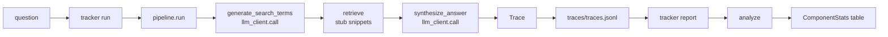
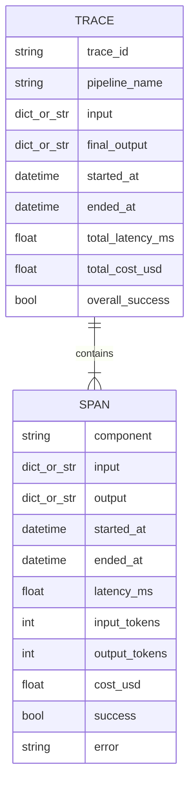

# agent-eval-tracker

A small CLI that runs a three-step research assistant, stores each run as a structured
trace, and reports failure rate, latency, and cost per component.

This is a demo of the build ↔ analyze loop, not a production observability stack. Retrieval
is stubbed. End-to-end success is a simple heuristic on the synthesis step.

## The build and analyze loop

[Agentic AI](https://www.deeplearning.ai/courses/agentic-ai) (Andrew Ng, DeepLearning.AI)
treats agent work as a loop: build a pipeline, run it, see which step failed, change that
step, run again. A final answer alone cannot name the failed step. This tool writes one
`Trace` per run (with a `Span` per component) to a JSON Lines file, then aggregates those
spans so you can see where to edit next.

## Schema

Runtime path from a question to the per-component report:



Data model: one `Trace` holds many `Span` records. `input` and `output` fields are
`dict | str` (or `None` where the model allows it).



## Why this project

When an agentic pipeline misbehaves, the failure is often in one component: bad search
terms, empty retrieval, or a weak synthesis. Logging only the final string hides that.
Spans with `success` and `error` make each failure countable across runs, so the next edit
can target the component with the highest failure rate. This repo shows that loop on a
small, testable pipeline.

## Setup

Python 3.11 or newer. Install with [uv](https://github.com/astral-sh/uv):

```bash
uv sync
```

Try the report on the checked-in sample first. It needs no API key:

```bash
uv run tracker report traces/sample_traces.jsonl --format markdown
```

For `tracker run`, the client reads only `ANTHROPIC_API_KEY` from the process environment.
A `.env` file is not loaded automatically. The default model is `claude-sonnet-4-6`.

```bash
export ANTHROPIC_API_KEY="sk-ant-..."
```

If you keep the key in a file, copy `.env.example` to `.env`, put the real key there, then
load it into the shell before you run the CLI:

```bash
cp .env.example .env
# edit .env, then:
set -a && source .env && set +a
```

Do not commit `.env`.

If `tracker run` prints `failed` and the trace shows `401` or `invalid x-api-key`, the key
in the environment is missing, expired, or wrong. Fix `ANTHROPIC_API_KEY` and run again.
The pipeline still writes a Trace with failed LLM spans instead of crashing.

## Run the pipeline

```bash
uv run tracker run "What are the main agentic design patterns?"
uv run tracker run --batch questions.txt
```

Each run appends one line to `traces/traces.jsonl`.

The three steps are:

1. `generate_search_terms` — LLM call
2. `retrieve` — stubbed search that always returns two fixed snippets (not a real search API)
3. `synthesize_answer` — LLM call

`overall_success` is true only when the `synthesize_answer` span succeeded and its output
text is non-empty. Failed earlier spans are still recorded. They do not define overall
success by themselves. Empty synthesis is marked `success=False` with error
`empty synthesis`.

A successful run looks like this (ids and numbers vary):

```text
ok trace_id=aaaaaaaa-bbbb-cccc-dddd-eeeeeeeeeeee spans=3 cost_usd=0.012345
The main agentic patterns include reflection and tool use.
```

A failed auth run looks like this:

```text
failed trace_id=5ec08d63-ae77-415d-a95c-995b8ac10a5b spans=3 cost_usd=0.000000
```

In that case the LLM spans carry the API error string, and `final_output` is `None`.

## Report failures per component

```bash
uv run tracker report traces/sample_traces.jsonl
uv run tracker report traces/sample_traces.jsonl --format markdown
uv run tracker report traces/sample_traces.jsonl --format json
```

Sample output (`--format markdown` on the checked-in sample file):

| component | calls | failures | failure_rate | avg_latency_ms | avg_cost_usd |
| --- | ---: | ---: | ---: | ---: | ---: |
| generate_search_terms | 3 | 1 | 33.3% | 100.0 | 0.000200 |
| retrieve | 3 | 0 | 0.0% | 13.3 | 0.000000 |
| synthesize_answer | 3 | 2 | 66.7% | 166.7 | 0.000467 |

Here `synthesize_answer` fails most often, so that is the step to inspect first.

## Demo script

For a recording or a quick end-to-end check (calls Anthropic; spends tokens):

```bash
uv run python examples/demo_run.py
```

## Tests

```bash
uv run pytest
```

Tests mock the Anthropic client. They do not call the real API.

## Limits

`append_trace` writes the JSON body and the newline in two `write` calls. Two processes that
append to the same file at the same time can tear a line. Prefer one writer at a time.
The checker under `.cursor/skills/verify-trace-append/` enumerates those schedules.

## Layout

- `src/tracker/trace.py` — `Span` / `Trace` and JSON Lines helpers
- `src/tracker/llm_client.py` — timed Anthropic call that returns a `Span`
- `src/tracker/pipeline.py` — research assistant (`generate_search_terms` → `retrieve` → `synthesize_answer`)
- `src/tracker/analysis.py` — per-component aggregates
- `src/tracker/cli.py` — `tracker run` and `tracker report`
- `traces/sample_traces.jsonl` — sample traces for `tracker report`
- `examples/demo_run.py` — short demo used for GIFs
